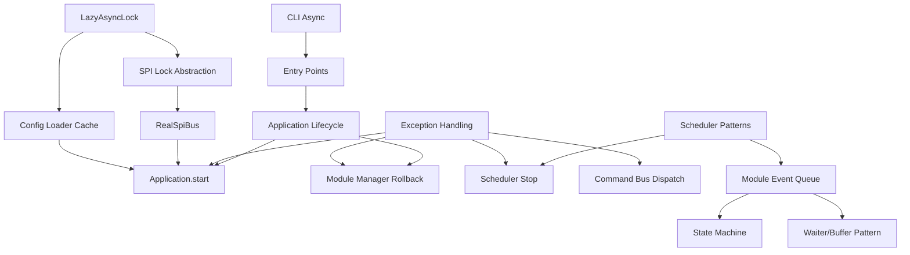

# MeshCore Pi LoRa — Architectural Patterns Index

## Overview

This index provides a quick reference to all architectural patterns established during the hardening spike (Plans 4-38, October-November 2026). Each pattern document captures the **what**, **why**, **how**, and **anti-regression rules** for a specific subsystem.

---

## Quick Reference

| Pattern | Document | Key Files | Semgrep Rules |
|---------|----------|-----------|---------------|
| **LazyAsyncLock** (Concurrency) | [concurrency_lazy_async_lock.md](concurrency_lazy_async_lock.md) | `framework/lazy_async_lock.py`, `drivers/spi/locks.py`, `drivers/rfm9x_sx127x_config_loader.py` | `lazy-async-lock-guard.yaml` |
| **Exception Handling** | [exception_handling.md](exception_handling.md) | `framework/application.py`, `framework/module_manager.py` | `exception_handling_guard.yaml` |
| **Application Lifecycle** | [application_lifecycle.md](application_lifecycle.md) | `framework/application.py` | `application_lifecycle_guard.yaml` |
| **Module Registration & Rollback** | [module_registration_rollback.md](module_registration_rollback.md) | `framework/module_manager.py` | `module_manager_guard.yaml` |
| **SPI Lock Abstraction** | [spi_lock_abstraction.md](spi_lock_abstraction.md) | `drivers/spi/locks.py`, `drivers/spi/bus.py` | `spi_lock_guard.yaml` |
| **Module Event Queue** | [module_event_queue.md](module_event_queue.md) | `drivers/rfm9x_sx127x_module.py`, `framework/events.py` | `module_event_queue_guard.yaml` |
| **Scheduler (Timer/Idle/Interrupt)** | [scheduler_patterns.md](scheduler_patterns.md) | `framework/scheduler.py` | `scheduler_guard.yaml` |
| **Command Bus** | [command_bus_patterns.md](command_bus_patterns.md) | `framework/command_bus.py` | `command_bus_guard.yaml` |
| **CLI Async (async-typer)** | [cli_async_patterns.md](cli_async_patterns.md) | `cli/_entry_points.py`, `cli/*.py` | `cli_async_guard.yaml` |
| **Semgrep Anti-Regression** | [semgrep_anti_regression.md](semgrep_anti_regression.md) | `.semgrep/rules/custom/*.yaml` | — |
| **Validation Gates & Testing** | [validation_gates_testing.md](validation_gates_testing.md) | `pyproject.toml`, `.semgrep/run.sh`, `tests/` | — |

---

## Pattern Relationships



---

## The Four Validation Gates (MUST PASS)

```bash
# 1. Type Checking
uv run mypy --strict src/

# 2. Linting & Formatting
uv run ruff check src/ tests/

# 3. Security Scanning
uv run .semgrep/run.sh

# 4. Unit Tests + Coverage
uv run pytest tests/ -x
uv run pytest tests/ --cov=pi_lora --cov-fail-under=90 -q

# Stress test (parallel)
uv run pytest tests/ -n auto
```

**All gates must pass with 0 errors before merge.**

---

## Core Design Principles

### 1. Single Pattern Authority
- **LazyAsyncLock** is THE pattern for lazy async locks
- No manual double-checked locking anywhere
- Semgrep enforces this

### 2. Exception Safety
- `CancelledError` NEVER swallowed — always re-raised
- `ExceptionGroup` caught BEFORE `Exception`
- Identity check before chaining (`if cleanup_exc is original: raise`)
- `asyncio.shield()` for all rollback operations

### 3. State Machine Clarity
- No fast-path reads for transitional booleans (`False→True→False`)
- Pending lists for atomic commit/rollback
- State cleared BEFORE awaits

### 4. Resource Safety
- Bounded queues (`maxsize=10000`) with drop-oldest
- `asyncio.shield()` prevents cancellation leaks
- Lock ordering in stop() — acquire FIRST, then flag

### 5. Test-Driven Anti-Regression
- Concurrency tests for every lock pattern
- Negative tests for every fixed bug
- Semgrep rule tests (`ruleid:`/`ok:`)
- Contract tests for protocol implementations

---

## Anti-Pattern Checklist (Code Review)

### Concurrency
- [ ] No `_SENTINEL = object()`
- [ ] No `asyncio.Lock()` created inside holder lock
- [ ] No dual init/else branches for lock init
- [ ] `LazyAsyncLock` used for ALL lazy async locks

### Exceptions
- [ ] No `except (Exception, asyncio.CancelledError):`
- [ ] `ExceptionGroup` before `Exception` in except clauses
- [ ] Identity check before `raise ... from ...`
- [ ] `asyncio.shield()` on all rollback coroutines

### Application Lifecycle
- [ ] No fast-path read of `_started` outside lock
- [ ] `errors = []` inside `async with lifecycle_lock`
- [ ] `_cleanup_partial_start()` acquires `lifecycle_lock`

### Module Manager
- [ ] Pending lists used (not direct `self.modules.append`)
- [ ] Scheduler register BEFORE tracking append
- [ ] Duplicate check on BOTH committed + pending
- [ ] Two except handlers: `(Exception, CancelledError)` + `BaseException`

### SPI Locks
- [ ] No sync context manager on SPI lock
- [ ] `_verify_single_registry()` scans `sys.modules`
- [ ] `aiologic` dependency pinned with upper bound

### Scheduler
- [ ] No `asyncio.sleep(0)` in loops
- [ ] Bounded queues with drop-oldest
- [ ] Backoff unconditional (not `if interval is not None`)
- [ ] `_failure_counts` cleaned on unregister
- [ ] Stop acquires lock FIRST

### Module Event Queue
- [ ] No direct `event_queue.put_nowait()` from sync context
- [ ] No `await event_queue.get()` outside event loop
- [ ] Explicit `StopMode` in `stop_event_loop()` calls
- [ ] Modes don't handle `STATE_CHANGE` (intercepted at module level)
- [ ] Waiter cleanup in `finally` block
- [ ] Buffer `maxlen=1000` per type (bounds memory)

### Command Bus
- [ ] `ExceptionGroup` before `Exception`
- [ ] Module resolver None check in `execute()`
- [ ] Module-level logger

### CLI
- [ ] No module-level `setup_logging()`
- [ ] `_run_app()` used for all entry points
- [ ] `async_typer.AsyncTyper` for all apps
- [ ] Commands are `async def`

---

## File Ownership Map

| Subsystem | Primary Files | Test Files |
|-----------|---------------|------------|
| Concurrency | `framework/lazy_async_lock.py` | `tests/framework/test_lazy_async_lock.py` |
| SPI Locks | `drivers/spi/locks.py`, `drivers/spi/bus.py` | `tests/drivers/spi/test_locks*.py` |
| Config Loader | `drivers/rfm9x_sx127x_config_loader.py` | `tests/drivers/test_config_loader*.py` |
| Application | `framework/application.py` | `tests/framework/test_application*.py` |
| Module Manager | `framework/module_manager.py` | `tests/framework/test_module_manager.py` |
| Module Event Queue | `drivers/rfm9x_sx127x_module.py` | `tests/drivers/test_rfm9x_sx127x_module*.py` |
| Scheduler | `framework/scheduler.py` | `tests/framework/test_scheduler.py` |
| Command Bus | `framework/command_bus.py` | `tests/framework/test_command_bus.py` |
| CLI | `cli/_entry_points.py`, `cli/*.py` | `tests/test_entry_points.py`, `tests/test_cli_*.py` |

---

## Historical Context

The hardening spike (Plans 4-38, 2026-10-10 to 2026-11-17) resolved **103+ defects** across **35 plans** with iterative code reviews at each step.

Key milestones:
- **Plan-4**: Initial 45+ architectural flaws identified
- **Plan-7**: async-typer migration
- **Plan-11**: 7 HIGH bugs fixed (introduced 8 new HIGH)
- **Plan-14**: 4 HIGH regressions fixed
- **Plan-28**: **LazyAsyncLock extracted** — systemic fix for Plans 22-27 bugs
- **Plan-38**: Final 8 CRITICAL/HIGH regressions fixed

---

## For Future Implementers

### When Adding New Code

1. **Check existing patterns first** — don't reinvent
2. **Use `LazyAsyncLock`** for any lazy async lock
3. **Follow exception handling patterns** exactly
4. **Add concurrency tests** for new locks
5. **Add semgrep rules** for new anti-patterns
6. **Run all 4 validation gates** before committing

### When Fixing Bugs

1. **Write a failing test first** (negative test)
2. **Fix the bug**
3. **Add semgrep rule** to prevent regression
4. **Document in pattern file** (update this index)
5. **Run all gates**

### When Reviewing Code

1. **Check anti-pattern checklist** above
2. **Verify semgrep passes** — rules exist for known bugs
3. **Check test coverage** — concurrency, negative, contract
4. **Validate exception handling** — order, chaining, shielding

---

## References

- `.plans/2026_10_08_hardening_spike/architect_review-4.md` — Full architectural review
- `.plans/2026_10_08_hardening_spike/docs/plan_summaries/2026_10_08_hardening_spike.md` — Durable summary
- `.plans/KNOWN_DEFECTS.md` — Tracked defects (resolved + deferred)
- `docs/patterns/` — This directory (all pattern documents)